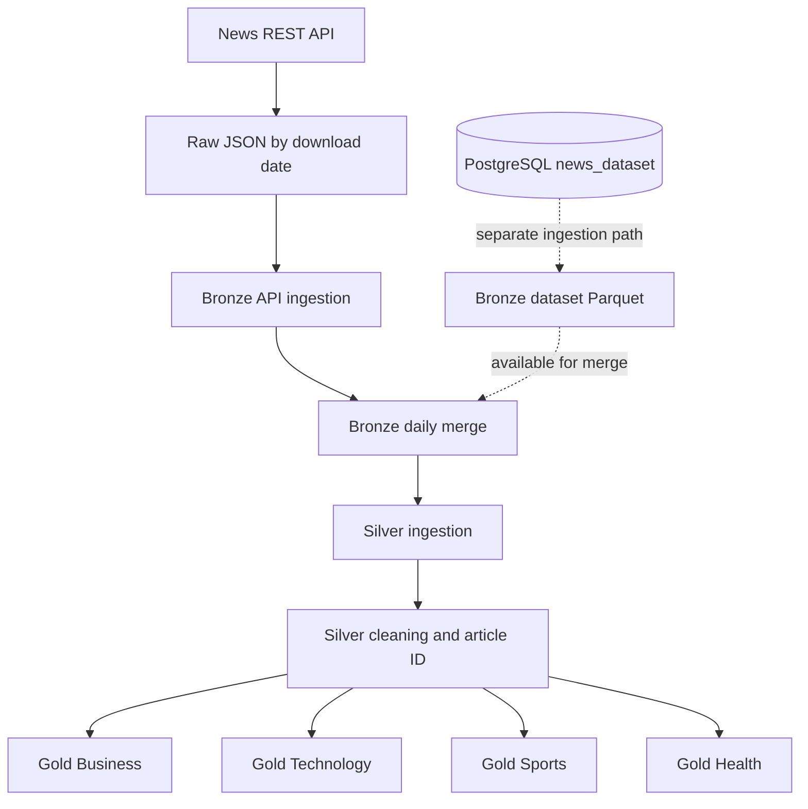

# Streamline News

A Python and Apache Spark data-engineering project that collects news articles from a REST API, stores raw API responses, processes article data through a Medallion-style Bronze–Silver–Gold pipeline, and produces category-oriented Parquet datasets for downstream analytics.

The project is organized around reusable pipeline classes, schema definitions, configuration loaded from environment variables, and application/database logging.

## Table of contents

- [Overview](#overview)
- [Architecture](#architecture)
- [Technology stack](#technology-stack)
- [Repository structure](#repository-structure)
- [Prerequisites](#prerequisites)
- [Setup](#setup)
- [Configuration](#configuration)
- [Run the pipeline](#run-the-pipeline)
- [Pipeline stages](#pipeline-stages)
- [PostgreSQL dataset ingestion](#postgresql-dataset-ingestion)
- [Output layout](#output-layout)
- [Logging](#logging)
- [Current implementation notes](#current-implementation-notes)
- [Potential next steps](#potential-next-steps)

## Overview

Streamline News brings together news data from an API and a structured dataset stored in PostgreSQL. Its Spark transformations standardize article fields, remove duplicate records, generate article identifiers, clean text columns, and classify articles into subject-specific analytical datasets.

The main daily workflow currently performs the following operations:

1. Requests the latest articles from the configured news API.
2. Saves the API response as a dated raw JSON file.
3. Reads the API articles and writes them to the Bronze layer as Parquet.
4. Creates a daily merged Bronze dataset.
5. Ingests and cleans the daily data in the Silver layer.
6. Builds Gold datasets for Business, Technology, Sports, and Health.

A separate PostgreSQL ingestion path is also present for loading the local structured news dataset into PostgreSQL and reading it into Bronze. That database path is not invoked by the current `run_daily()` workflow.

## Architecture



### Medallion layers

| Layer | Purpose | Current output |
|---|---|---|
| Raw | Preserve the API response with its download date and source metadata | JSON files under `data/api/raw/` |
| Bronze | Read API articles into a consistent article structure; retain a separate path for the PostgreSQL dataset | Parquet under `data/bronze/` |
| Silver | Remove duplicates, fill missing values during ingestion, generate an `article_id`, rename the image field, and trim text columns | Parquet under `data/silver/` |
| Gold | Classify articles into subject areas and add publication date/year/month fields | Parquet under `data/gold/` |

The paths above are the defaults used in the supplied `.env` file. They can be changed through environment configuration.

## Technology stack

- **Python** – application code and pipeline orchestration
- **Apache PySpark** – distributed data processing and Parquet I/O
- **PostgreSQL** – structured dataset source for the optional database ingestion path
- **REST API** – external news article source
- **Parquet** – columnar storage format for Bronze, Silver, and Gold data
- **psycopg2** – Python PostgreSQL connectivity
- **python-dotenv** – environment-based configuration
- **Requests** – HTTP requests to the news API
- **Logging** – application and database log files

## Repository structure

```text
streamline-news/
├── src/
│   ├── main.py
│   ├── api/
│   │   └── api_client.py
│   ├── database/
│   │   └── db_client.py
│   ├── pipeline/
│   │   ├── pipeline_runner.py
│   │   ├── bronze_pipeline.py
│   │   ├── silver_pipeline.py
│   │   └── gold_pipeline.py
│   ├── schema/
│   │   ├── news_api_schema.py
│   │   ├── news_article_schema.py
│   │   ├── news_dataset_schema.py
│   │   ├── news_bronze_schema.py
│   │   └── news_silver_schema.py
│   └── utils/
│       ├── app_config.py
│       ├── logger.py
│       ├── read_df.py
│       ├── spark_sesssion_factory.py
│       └── unique_article_id.py
├── logs/
│   ├── application/
│   └── database/
├── requirements.txt
├── .env                 # create locally; do not commit credentials
└── README.md
```

## Prerequisites

Before running the project, make sure you have:

- Python installed.
- Java installed and configured for the PySpark version in your environment.
- Apache Spark dependencies available through PySpark.
- Access to the news API and a valid API key.
- PostgreSQL credentials and a reachable database if you intend to use the optional PostgreSQL ingestion path.

The Spark session is configured with `local[*]`, so the current application runs Spark locally using the available CPU cores. It also configures the PostgreSQL JDBC driver package `org.postgresql:postgresql:42.7.3` for Spark JDBC reads.

## Setup

### 1. Clone the repository

```bash
git clone https://github.com/ECcentricOG/streamline-news.git
cd streamline-news
```

### 2. Create and activate a virtual environment

```bash
python -m venv .venv
```

macOS / Linux:

```bash
source .venv/bin/activate
```

Windows PowerShell:

```powershell
.venv\Scripts\Activate.ps1
```

### 3. Install dependencies

```bash
pip install --upgrade pip
pip install -r requirements.txt
```

If the PostgreSQL Python driver cannot be installed in your environment, use the platform-compatible `psycopg2-binary` package in place of `psycopg2` for local development, and keep the dependency declaration consistent with your deployment environment.

### 4. Create the environment file

Create a `.env` file in the repository root. Use the variable names below and replace the example values with your own settings.

```dotenv
# PostgreSQL connection (used by the optional database ingestion path)
DB_HOST=localhost
DB_PORT=5432
DB_USER=your_username
DB_PASSWORD=your_password
DB_NAME=your_database

# News API
API_KEY=your_news_api_key
BASE_URL=https://your-news-api-endpoint

# Source data
RAW_DATASET_FILE_PATH=data/dataset/raw/news_dataset.json
RAW_API_DATA_DIR=data/api/raw

# Bronze layer
BRONZE_DATASET_DIR=data/bronze/dataset
BRONZE_API_DIR=data/bronze/api
BRONZE_MERGE_DIR=data/bronze/merge

# Silver layer
SILVER_INGEST_DIR=data/silver/ingest
SILVER_TRANSFORM_DIR=data/silver/transform

# Gold layer
GOLD_FACT_BUSINESS_DIR=data/gold/fact_business
GOLD_FACT_TECH_DIR=data/gold/fact_tech
GOLD_FACT_SPORT_DIR=data/gold/fact_sport
GOLD_FACT_HEALTH_DIR=data/gold/fact_health
```

`BASE_URL` must be the endpoint expected by the configured API and return a response containing a `status` field and an `articles` array with the fields defined in `src/schema/news_api_schema.py`.

**Keep `.env` private.** It contains credentials and API keys. Do not commit it to GitHub. The repository's `.gitignore` excludes `.env`.

### 5. Prepare the source dataset (optional)

The PostgreSQL ingestion code expects a JSON Lines input file at `RAW_DATASET_FILE_PATH`. Each non-empty line must be a JSON object containing these fields:

```json
{
  "link": "https://example.com/article",
  "headline": "Example headline",
  "category": "Business",
  "short_description": "Short article summary",
  "authors": "Example Author",
  "date": "2026-11-05"
}
```

The example above illustrates the expected record shape; the actual input file should contain one JSON object per line. The corresponding PostgreSQL table defaults to `news_dataset` and should have matching columns: `link`, `headline`, `category`, `short_description`, `authors`, and `date`.

## Configuration

`src/utils/app_config.py` loads settings from `.env` through `python-dotenv`. The application uses these settings for API access, database connectivity, and the Raw/Bronze/Silver/Gold storage paths.

All configured data paths are local relative paths in the supplied configuration. If you change them to cloud storage paths, verify that the Spark runtime has the required filesystem connector, permissions, and configuration; cloud storage access is not configured by the current source code itself.

## Run the pipeline

The current entry point is `src/main.py`. Run it from the `src` directory so that the project's package imports resolve correctly:

```bash
cd src
python main.py
```

### Set the processing date

The processing date is currently hard-coded in `src/main.py`:

```python
download_date = "2026-11-05"
```

Change this value to the date you want to process before running the application. The same date is passed to the API client and the Bronze, Silver, and Gold pipeline classes. The current code does not calculate the date automatically or accept it as a command-line argument.

The API client skips downloading when the raw JSON file for that date already exists. Several later stages also check for existing daily output paths and skip writing when those paths are present. If you need to rerun a date, review the corresponding output directories first; do not delete data unless you are sure it can be regenerated.

## Pipeline stages

### 1. API extraction

Implemented in `src/api/api_client.py`.

- Sends a GET request to the configured `BASE_URL`.
- Sends the API key, English language, page size, and page number as request parameters.
- Checks the HTTP response and the API response status.
- Saves the complete response to `data/api/raw/<date>.json` (or the configured raw API directory).
- Adds `download_date` and `source` metadata around the API response.
- Skips the request when that date's raw JSON file already exists.

### 2. Bronze ingestion and merge

Implemented in `src/pipeline/bronze_pipeline.py`.

- Reads the dated raw JSON using the explicit API schema.
- Explodes the nested `data.articles` array into individual article records.
- Selects source name, author, title, description, URL, image URL, publication timestamp, and content.
- Writes API article records to the dated Bronze API directory in Parquet format.
- Aligns API fields with the structured dataset fields when building a combined dataset.

The Bronze pipeline also contains a PostgreSQL JDBC reader (`broze_ingest_database`) that writes the `news_dataset` table to the configured Bronze dataset path. The database-to-Bronze method and the full merge method are available separately; they are not called by the current `run_daily()` sequence.

### 3. Silver ingestion and transformation

Implemented in `src/pipeline/silver_pipeline.py`.

The ingestion step:

- Reads the daily Bronze merge output.
- Removes duplicate rows.
- Fills missing values with `Unknown`.
- Writes the result to the Silver ingestion directory.

The transformation step:

- Generates an `article_id` using a SHA-256-derived value based on a UUID.
- Renames `urlToImage` to `image`.
- Removes duplicate rows.
- Trims whitespace from selected text fields.
- Converts null or empty text values to null.
- Writes transformed Parquet data to the Silver transformation directory.

### 4. Gold analytical datasets

Implemented in `src/pipeline/gold_pipeline.py`.

The Gold pipeline reads transformed Silver data and applies keyword-based classification to article title, description, and content. It creates four datasets:

| Gold dataset | Example subject areas |
|---|---|
| Business | Stock Market, Banking & Finance, Economy, Corporate, Cryptocurrency, Energy |
| Technology | Artificial Intelligence, Cloud Computing, Cybersecurity, Robotics, Semiconductors, Software Applications, Telecom |
| Sports | Cricket, Football, Tennis, Badminton, Basketball, Golf, Hockey, Olympics |
| Health | Healthcare, Disease, Diagnosis, Medical Research, Mental Health, Nutrition, Pharmaceuticals, Vaccine, Wellness |

Articles that do not match a category are excluded from the corresponding subject dataset. The Gold transformations also derive `published_date`, `published_year`, and `published_month` from the publication timestamp. The daily methods write date-specific Parquet outputs; full-dataset methods are also defined in the class.

## PostgreSQL dataset ingestion

The project includes a separate PostgreSQL path:

1. `DatabaseClient.insert()` reads the JSON Lines file configured by `RAW_DATASET_FILE_PATH` and inserts its records into the `news_dataset` table.
2. `BronzePipeline.broze_ingest_database()` reads that table using Spark JDBC and writes it to `BRONZE_DATASET_DIR`.
3. `BronzePipeline.merge_data()` can align and union the database dataset with the API article dataset.

These operations are exposed through methods on `PipelineRunner`, but the current `run_daily()` method does not invoke them. The daily workflow therefore should not be assumed to refresh PostgreSQL data automatically.

## Output layout

With the paths in the example configuration, the pipeline uses a layout similar to:

```text
data/
├── dataset/
│   └── raw/
│       └── news_dataset.json
├── api/
│   └── raw/
│       └── YYYY-MM-DD.json
├── bronze/
│   ├── dataset/
│   ├── api/
│   │   └── YYYY-MM-DD/
│   └── merge/
│       └── YYYY-MM-DD/
├── silver/
│   ├── ingest/
│   │   └── YYYY-MM-DD/
│   └── transform/
│       └── YYYY-MM-DD/
└── gold/
    ├── fact_business/
    │   └── YYYY-MM-DD/
    ├── fact_tech/
    │   └── YYYY-MM-DD/
    ├── fact_sport/
    │   └── YYYY-MM-DD/
    └── fact_health/
        └── YYYY-MM-DD/
```

Spark writes Parquet datasets as directories containing one or more part files and metadata files; the output is not necessarily a single `.parquet` file.

## Logging

The logger utility writes timestamped log messages to both the console and log files:

- Application logs: `logs/application/application.log`
- Database logs: `logs/database/database.log`

The log directory is created automatically when a logger is initialized. Avoid committing logs if they contain operational details or data that should remain private.

## Current implementation notes

This section describes the supplied source code so users can distinguish implemented functionality from planned extensions:

- The Spark session runs locally with `local[*]`.
- The processing date is hard-coded in `src/main.py` and must be updated manually.
- The current `run_daily()` workflow processes the API source through the daily Bronze, Silver, and Gold methods.
- PostgreSQL insertion and PostgreSQL-to-Bronze ingestion methods exist, but are not part of `run_daily()`.
- The configured data paths are local `data/` directories. The supplied code does not currently configure Google Cloud Storage buckets or upload outputs to GCS.
- No Airflow DAG or GitHub Actions workflow is included in the supplied project files.
- The repository does not currently include an automated test suite.
- The article identifier is generated from a UUID-derived hash. It is generated during the Silver transformation and should not be treated as a stable identifier across independent full reprocessing runs.

## Potential next steps

Possible improvements as the project evolves:

- Replace the hard-coded date with a command-line argument or scheduled execution date.
- Add automated tests for API parsing, schema handling, transformations, and category classification.
- Add data-quality checks for required fields, malformed URLs, publication timestamps, and duplicate article URLs.
- Make the article identifier deterministic using a stable article attribute such as the canonical URL.
- Add structured configuration validation and clearer exception propagation.
- Integrate orchestration (for example, Apache Airflow) after the pipeline stages are independently reliable.
- Add and validate cloud storage support before documenting GCS as a deployment target.
- Add CI checks for formatting, linting, and tests.

## Contributing

Contributions and suggestions are welcome. For a change, create a branch, make the update, and open a pull request with a clear description of the behavior changed and any validation performed.

## License

No license file was included in the supplied project archive. Add a `LICENSE` file before describing the repository as open source or specifying reuse permissions.

